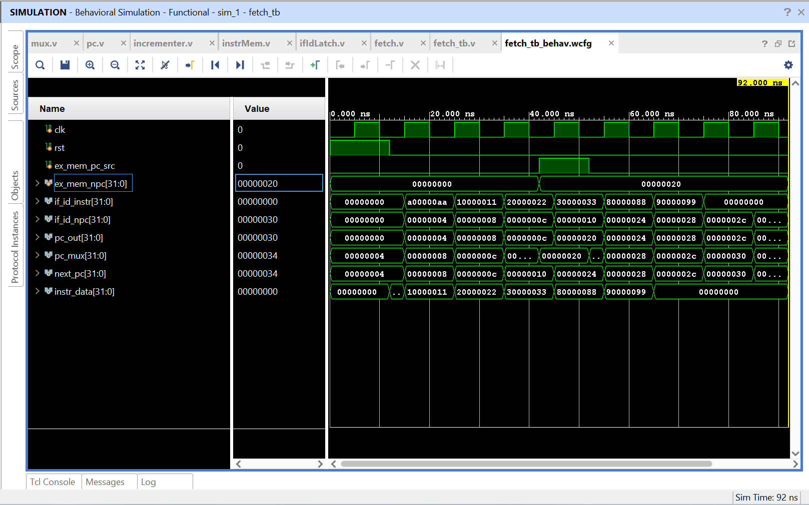

# MIPS Fetch Stage

This project implements and simulates the Instruction Fetch (IF) stage of a MIPS pipelined processor using Verilog and Vivado.

## Components

- `mux.v` — Selects either PC + 4 or the branch target address
- `pc.v` — Stores the current program counter
- `incrementer.v` — Calculates PC + 4
- `instrMem.v` — Stores and returns 32-bit instructions
- `ifIdLatch.v` — Stores the fetched instruction and next PC
- `fetch.v` — Connects all Fetch-stage components
- `fetch_tb.v` — Tests sequential instruction fetching and branching

## Operation

During normal execution, the program counter advances by four for each instruction. When `ex_mem_pc_src` is 1, the multiplexer selects `ex_mem_npc` as the next PC. The IF/ID latch stores the fetched instruction and next PC on each rising clock edge.

The testbench demonstrates sequential fetching followed by a branch to address `0x20`. The Fetch stage then retrieves instruction `0x80000088` and continues sequentially.

## Simulation Waveform

## Tools

- Verilog
- AMD Vivado Simulator# MIPS-Fetch-Stage
